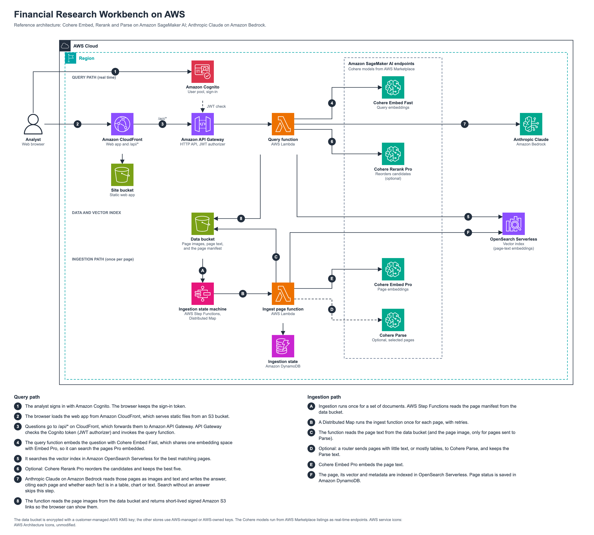
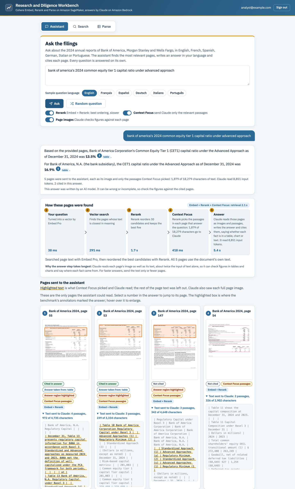
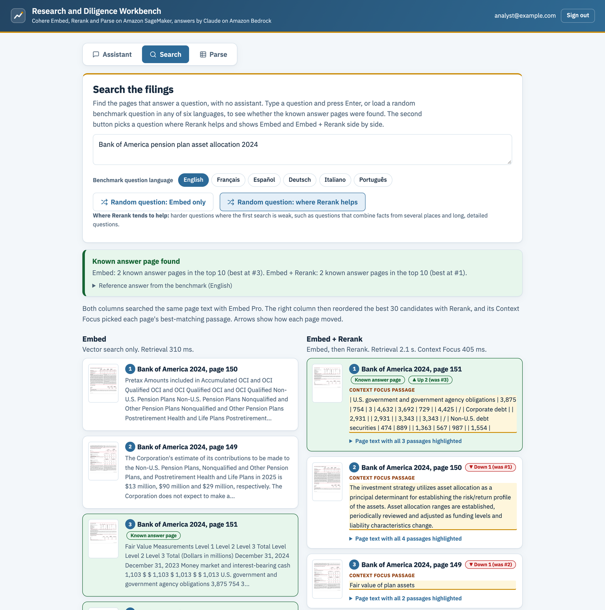
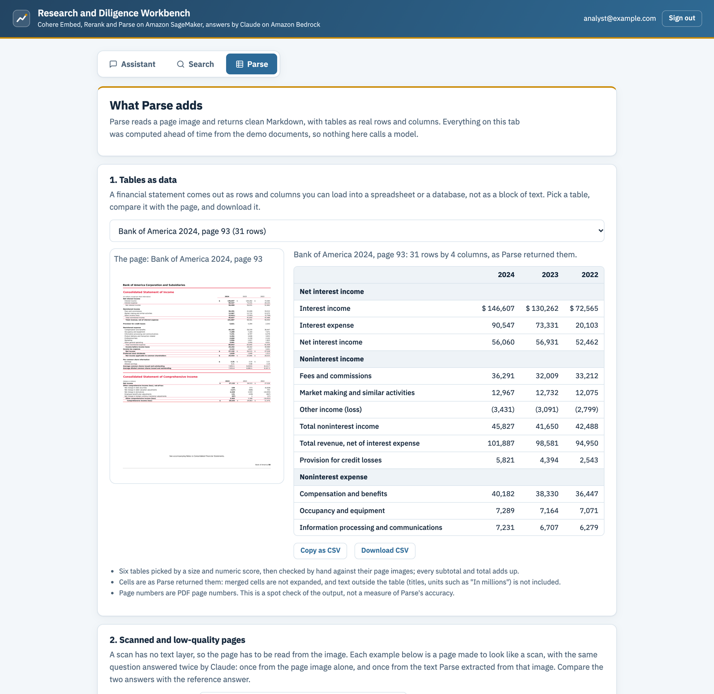

# Financial Research Workbench on AWS

A CloudFormation demo of Cohere Embed, Rerank and Parse on Amazon SageMaker AI, with Anthropic Claude on Amazon Bedrock, applied to public bank annual reports. You ask a question, the app finds the right pages, writes a cited answer, and shows the page.

Companion to the [Cohere Embed announcement](https://cohere.com/blog/embed-5). **Demo only, not for production use.**



The diagram is the reference architecture, which queries with Embed Fast. To keep the GPU count down, this demo deploys one Embed Pro endpoint and uses it for both pages and questions; Pro and Fast share an embedding space, so the index works with either.

## What you get

A web app (sign-in required) with three tabs:

| Tab | What it does |
|---|---|
| **Assistant** | Ask a question in English, French, Spanish, German, Italian or Portuguese, or press **Random question** if you do not know what to ask. The app searches the pages with Embed Pro, reorders the best candidates with Rerank, and Claude reads the top five pages as images and text, then writes an answer, in your language, that cites each page and says whether the fact came from a table, a chart, body text, a footnote or a figure. A **Rerank switch** turns reordering on or off for the next question. With Rerank on, **Context Focus** sends Claude only the passages Rerank marked as answering the question, and highlights them in each page's text; **Page images** decides whether the page images go to Claude as well. The flow strip shows what each step took and how many tokens Claude read and wrote. |
| **Search** | The same retrieval with no generated answer. For the 168 benchmark questions, in six languages, it also shows whether a known answer page was found. In the side-by-side view, the Embed + Rerank column shows the passage Context Focus picked on each page. |
| **Parse** | What Cohere Parse adds, from precomputed results shipped in this repository (no Parse endpoint needed): tables as rows you can download as CSV, and a scan-quality test comparing Claude reading a degraded page image with Claude reading the text Parse extracted. |

What you see when you deploy and run it yourself may differ from the screenshots below.

<details>
<summary><strong>Assistant</strong>: a cited answer, the steps that found the pages, and the passages Context Focus sent to Claude</summary>



</details>

<details>
<summary><strong>Search</strong>: Embed alone next to Embed + Rerank on a benchmark question, with the known answer pages marked</summary>



</details>

<details>
<summary><strong>Parse</strong>: a table from a page as rows, next to the page it came from</summary>



</details>

Search and the Assistant use **Embed + Rerank**. In the full design, Parse is an optional stage for scans, pages with little text, or when you need tables as data; this demo does not run it and shows its saved results in the Parse tab instead. The [decision tree](docs/architecture/decision-tree.png) and the [pipeline with its optional stages](docs/architecture/pipeline-optional-stages.png) show when to use each stage.

The documents are in English. Questions in the other five languages find the same English pages, which is what you would see with a multilingual archive.

## Deploy it step by step

Plan for about an hour from a clean start to your first answer: about 15 minutes of setup, 15 to 20 minutes while the stack creates, and a few minutes to ingest. The two GPU endpoints bill from the moment they start (about $8.21 per hour, see [Cost](#cost)), so do steps 1 to 4 before you deploy, and step 9 when you finish.

The repository carries the template, the code, the benchmark questions and the saved Parse results the app shows. The page images and page text are downloaded from the public dataset in step 6, so nothing large is stored here.

### Step 1. Get the tools

On your computer you need:

- The [AWS CLI v2](https://docs.aws.amazon.com/cli/latest/userguide/getting-started-install.html), with a profile for your account (see below).
- Python 3.9 or later, with `pip`.
- Bash (macOS, Linux, or WSL on Windows).
- About 3 GB of free disk space for the dataset download.

Clone the repository, change to this sample's folder, and install the Python packages into a virtual environment:

```bash
git clone https://github.com/aws-samples/Cohere-on-AWS.git
cd Cohere-on-AWS/rag-recipes/financial-research-assistant
python3 -m venv .venv
source .venv/bin/activate
pip install -r scripts/requirements-data.txt cfn-lint
```

Use **us-east-1** for everything: the Cohere model package ARNs in the template are for that Region only.

**Find your AWS profile.** Every command below takes `--profile <profile>`, the name of the AWS CLI profile for the account you deploy into. To see the profiles on your computer:

```bash
aws configure list-profiles
```

Profiles are defined in `~/.aws/config`. If yours uses access keys, the keys are stored in `~/.aws/credentials`, under the profile name in square brackets. If you have no profile yet, create one with `aws configure` (access keys) or `aws configure sso` (IAM Identity Center sign-in). For an SSO profile, sign in first with `aws sso login --profile <profile>`; you need to do this again when the session expires. Check that the profile works, and which account it points to, with:

```bash
aws sts get-caller-identity --profile <profile>
```

### Step 2. Subscribe to the Cohere models on AWS Marketplace

In the AWS Marketplace console, subscribe to [**Cohere Embed Pro**](https://aws.amazon.com/marketplace/pp/prodview-pobc74bcuaohi) and [**Cohere Rerank Fast**](https://aws.amazon.com/marketplace/pp/prodview-uu644hmeoibm2). [Cohere's SageMaker setup guide](https://docs.cohere.com/docs/amazon-sagemaker-setup-guide) walks through the subscription. The model package ARNs the template uses are in [`template/stacks/models.yaml`](template/stacks/models.yaml).

Subscribing costs nothing by itself; the software fee is charged per hour while an endpoint runs. A stack launched without the subscriptions fails when it creates the models.

### Step 3. Turn on Claude in Amazon Bedrock

In the Amazon Bedrock console in us-east-1, make sure your account can use **Anthropic Claude Sonnet 4.5**. If you have not used an Anthropic model in this account before, Bedrock asks for a short use-case form first. The app calls it through the US cross-Region inference profile `us.anthropic.claude-sonnet-4-5-20250929-v1:0` (the `ClaudeInferenceProfileId` parameter).

### Step 4. Check your account

```bash
python scripts/preflight.py --profile <profile>
```

It checks the Region, the SageMaker quota for `ml.g5.xlarge for endpoint usage` (at least 2), Bedrock access with a one-token Claude call, and endpoints that already exist (they count against the quota). Fix anything it reports before you go on. New accounts often start with a lower quota: request an increase in the Service Quotas console under Amazon SageMaker, and wait for it to be approved. The script cannot check the Marketplace subscriptions from step 2.

### Step 5. Deploy the stack

```bash
scripts/deploy.sh <profile> AdminEmail=<you@example.com>
```

This creates a CloudFormation stack named `frw` with everything the demo needs. It takes about 15 to 20 minutes, mostly to start the two GPU endpoints; you can watch progress in the CloudFormation console. The script also creates a private S3 bucket, `frw-artifacts-<account ID>-us-east-1`, to hold the files CloudFormation deploys from. Soon after it starts, Cognito emails your `AdminEmail` address a temporary password for the web app.

If the stack fails, open the first failed event in the CloudFormation console. The usual causes are a missing Marketplace subscription (step 2), too little SageMaker quota (step 4), or `InsufficientInstanceCapacity`, which means AWS had no `ml.g5.xlarge` capacity at that moment: wait and run the same command again.

### Step 6. Load the data

This downloads the public dataset (ViDoRe V3 Finance, English: three FY2024 bank annual reports, 928 pages) from Hugging Face and writes the page images, page text, page manifest and benchmark questions into the stack's data bucket. It needs no GPU, so you can run it in a second terminal while step 5 is still running. The data bucket is created in the first minutes of the deployment; its name is `<ProjectName>-data-<account ID>-us-east-1`, with `ProjectName` `frw` by default:

```bash
ACCOUNT=$(aws sts get-caller-identity --query Account --output text --profile <profile>)
python scripts/prepare_data.py --bucket frw-data-$ACCOUNT-us-east-1 --profile <profile>
```

Once the stack is complete you can use `--stack frw` instead of `--bucket`. Plan for about 2 GB of download (kept in `.cache/dataset`) and roughly 10 minutes. Add `--dry-run` to check without writing. It is safe to run again: pages already in the bucket are skipped.

### Step 7. Start ingestion

When the stack is complete and both endpoints show **InService** (SageMaker console, Inference, Endpoints), start ingestion once:

```bash
python scripts/start_ingestion.py --stack frw --profile <profile>
```

It checks that the manifest is in the bucket and that the endpoints are ready, then starts the Step Functions state machine that embeds every page and writes it to the vector index. The 928 pages take about 5 minutes. Follow it in the Step Functions console; the execution should end as **Succeeded**. For a summary of the run (pages done and failed), run `python scripts/ingest_report.py --profile <profile>`.

### Step 8. Sign in and try it

Get the site address from the stack outputs:

```bash
aws cloudformation describe-stacks --stack-name frw --region us-east-1 --profile <profile> \
  --query "Stacks[0].Outputs[?OutputKey=='SiteUrl'].OutputValue" --output text
```

Open it, sign in with your `AdminEmail` address and the temporary password from the email, and choose a new password. Then:

- **Assistant:** press **Random question** (the first few are questions answered from a table), or ask your own, for example "What was Bank of America's CET1 ratio under the Advanced approach in 2024?" Check the citation labels (table, chart, text), open a cited page, and hover over the highlighted region on a page to enlarge it. Turn the **Rerank** switch off and on to see what changes, then try **Context Focus** and **Page images** to see which text and images went to Claude and how the token count changes.
- **Languages:** under **Sample question language**, pick French or German and press **Random question** again. The pages are in English, and the answer comes back in the question's language.
- **Search:** press **Random question: where Rerank helps** to see the Embed and Embed + Rerank results side by side, with the Context Focus passage on each reranked page.
- **Parse:** compare a table page with the rows Parse extracted, and use **Download CSV** to take them into a spreadsheet.

### Step 9. Stop the charges when you are done

To stop the endpoint charges but keep everything else (the data, the index and your sign-in), turn the endpoints off:

```bash
scripts/deploy.sh <profile> DeployModels=false
```

To use the app again later, run the same command with `DeployModels=true` and wait about 15 minutes; there is no need to load or ingest the data again. Check that nothing is left running with:

```bash
aws sagemaker list-endpoints --region us-east-1 --profile <profile> --query "Endpoints[].EndpointName"
```

To remove everything, delete the stack (the stack empties its own buckets first), then delete the artifact bucket that `deploy.sh` created:

```bash
aws cloudformation delete-stack --stack-name frw --region us-east-1 --profile <profile>
aws cloudformation wait stack-delete-complete --stack-name frw --region us-east-1 --profile <profile>
ACCOUNT=$(aws sts get-caller-identity --query Account --output text --profile <profile>)
python -c "import boto3, sys; boto3.Session(profile_name=sys.argv[1]).resource('s3').Bucket(sys.argv[2]).object_versions.delete()" \
  <profile> frw-artifacts-$ACCOUNT-us-east-1
aws s3 rb s3://frw-artifacts-$ACCOUNT-us-east-1 --profile <profile>
```

The `python` line deletes every stored version of the files, not only the current ones, because some accounts turn on bucket versioning automatically, and a versioned bucket can only be deleted once it holds no versions at all.

Cancel the Marketplace subscriptions as well if you no longer want them. The dataset download in `.cache/dataset` can be deleted at any time.

## How it works

[`docs/architecture.md`](docs/architecture.md) explains the two flows (ingestion, and answering a question), what each component does and why it is needed, and how the stack is organised.

## Stack parameters

| Parameter | Default | Meaning |
|---|---|---|
| `AdminEmail` | empty | Creates the first web app user; Cognito emails a temporary password. |
| `AppTitle` | Research and Diligence Workbench | Title shown in the app. |
| `ProjectName` | `frw` | Prefix for resource names. |
| `DeployModels` | `true` | Set to `false` to delete the GPU endpoints and keep everything else. |
| `DeployRerank`, `RerankEndpointName` | `true`, empty | Set `DeployRerank=false` and give your own rerank endpoint's name to use it instead of the one this stack creates. |
| `ClaudeInferenceProfileId` | US cross-Region Sonnet profile | Bedrock inference profile used for answers. |
| `IndexName` | `pages` | OpenSearch index used by ingestion and the app. |
| `CreateIndex` | `true` | Whether the stack creates the index. |
| `ExtraAossPrincipalArn` | empty | Optional: an extra IAM role ARN given access to the vector collection, for example to query the index from your own role. |

## Cost

The cost is almost all GPU endpoints that bill **every hour they exist**, used or not. Prices are US East (N. Virginia) list prices, checked 2026-10-09; confirm them before you rely on them.

| Item | Rate | Notes |
|---|---|---|
| Embed Pro endpoint (`ml.g5.xlarge`) | $1.41 instance + $2.39 software = about **$3.80 per hour** | Software fee from the Embed Pro Marketplace listing. |
| Rerank Fast endpoint (`ml.g5.xlarge`) | $1.41 instance + $3.00 software = about **$4.41 per hour** | Software fee from the [Marketplace listing](https://aws.amazon.com/marketplace/pp/prodview-uu644hmeoibm2). |
| OpenSearch Serverless | $0.24 per OCU-hour, $0.024 per GB-month | The collection scales to zero when idle. The template caps it at 4 indexing and 4 search OCUs, so at most about $1.92 per hour while it is busy. We did not measure the bill. |
| Claude Sonnet 4.5 on Bedrock | $3 per million input tokens, $15 per million output tokens | An answer sends 5 pages, each as its image and up to 6,000 characters of text, and writes at most 800 tokens. That is roughly 5 cents per answer, most of it for the page images and text sent in. The model ID is a US cross-region inference profile; check the Bedrock pricing page for your account. |
| S3, CloudFront, Cognito, Lambda, API Gateway, Step Functions | Cents for this demo | We did not measure these. |

**What that adds up to** (default setup, two endpoints, about $8.21 per hour):

- **A 2-hour session: about $16.** A 4-hour session: about $33. Allow 15 to 20 minutes for the endpoints to start and about 5 minutes to ingest the 928 pages. All of that time is billed.

When you are done:

1. Update the stack with `DeployModels=false` to delete the endpoints (search and the Assistant stop working until you turn them back on), then check that `aws sagemaker list-endpoints` shows none from this stack; or
2. Delete the stack (see step 9 above).

Cancel the Marketplace subscriptions separately if you no longer want them. Set an [AWS Budgets](https://docs.aws.amazon.com/cost-management/latest/userguide/budgets-managing-costs.html) alert before you start; the template does not create one.

## Repository layout

- `template/`: the CloudFormation templates (`main.yaml` and its nested stacks).
- `src/lambdas/`: the query and ingestion functions.
- `src/ui/`: the web app (including the benchmark questions and saved Parse results it shows) and the function that publishes it.
- `scripts/`: deploy, preflight check, data loading, ingestion start and ingestion report.
- `docs/architecture.md`: how it works.
- `docs/architecture/`: the architecture, decision-tree and pipeline diagrams.

## License

This sample is part of [Cohere on AWS](https://github.com/aws-samples/Cohere-on-AWS) and is licensed under the MIT-0 License; see the `LICENSE` file at the root of that repository.

## Attribution

See [`NOTICE.md`](NOTICE.md) for the data sources and the licences of the dataset and the font.
