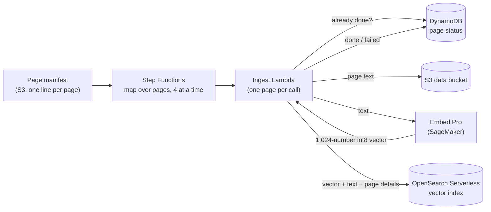
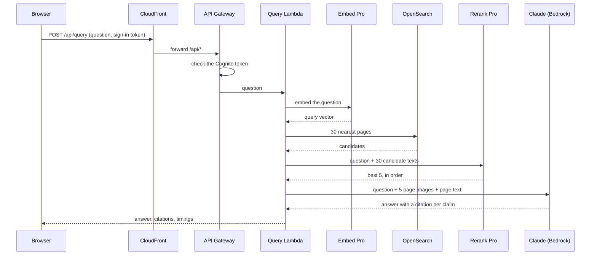

# How it works

This page explains what the stack deploys, how a page gets into the index, how a question becomes a cited answer, and why each component is there. For deployment, see the [README](../README.md).

The diagram shows the reference design, which answers questions with Embed Fast. To keep the GPU count down, the demo uses its one Embed Pro endpoint for both pages and questions. Pro and Fast share an embedding space, so the same index works with either.

## The two flows

The system has two flows that share one vector index:

- **Ingestion** runs once, after you load the data. It turns each of the 928 pages into a vector and stores it in the index.
- **Answering** runs on every question. It finds the best pages for the question and has Claude write an answer that cites them.

### Ingestion: from page to index

1. `scripts/start_ingestion.py` starts the Step Functions state machine on the page manifest in the data bucket (a JSON Lines file with one line per page).
2. The state machine reads the manifest and calls the ingest Lambda function once per page, four pages at a time. A page that fails is retried up to three times, with a growing wait in between.
3. For each page, the function:
   - checks the status table in DynamoDB and skips the page if it is already done;
   - checks that the page image exists (the app shows it later) and reads the page text;
   - sends the text to Embed Pro, which returns a vector of 1,024 small integers (int8) that captures what the page is about;
   - writes the vector, the text and the page details (document, page number, image location) to the vector index;
   - records the result in the status table: done, or failed with the step and the error.
4. When every page is processed, the state machine writes a run summary to the data bucket (`runs/`). `scripts/ingest_report.py` summarises the status table.

A page with no text at all, such as a cover or a divider page, is recorded without a vector, so search never returns it.

### Answering: from question to cited answer

1. The browser sends the question, with the user's sign-in token, to `/api/query`. CloudFront passes it to API Gateway, which checks the token against Cognito before calling the query Lambda function.
2. The function sends the question to Embed Pro, marked as a search query, and gets back a vector in the same space as the page vectors.
3. It asks OpenSearch for the nearest pages. With Rerank on, it takes 30 candidates; with Rerank off, it takes the top 5 straight away.
4. **Rerank**: Rerank Fast reads the question together with each candidate's text (up to 3,000 characters per page) and scores how well each page answers it. The best 5 go forward. Vector search compares a page and a question as two separately made summaries; Rerank reads them side by side, which is slower but more precise. With **Context Focus** on, a second Rerank call on the 5 chosen pages (up to 6,000 characters each) returns the passages that answer the question, as character offsets; it does not change the order.
5. **Answer**: the function loads the 5 page images from S3 and sends them to Claude on Amazon Bedrock with each page's text (up to 6,000 characters), or only its Context Focus passages, and the question. With **Page images** off, the images are not loaded or sent. Claude is told to use only those pages, to trust the image where the text and the image disagree, and to cite every claim with its page and whether it came from a table, a chart, body text, a footnote or a figure. The answer is limited to 800 tokens.
6. The browser shows the answer, the cited pages, the time each step took and how many tokens Claude read and wrote. With Context Focus on, each page's text shows the passages that were sent highlighted. Clicking a citation asks `/api/page-image` for a link to that page image, valid for 15 minutes.

**Search** uses the same steps 1 to 4 and stops before the answer, returning the top 10 pages. Its "where Rerank helps" button runs the question twice, with and without Rerank, to show both result lists; the Embed + Rerank list also asks for Context Focus, to show the best passage on each page.

The API has a 30-second limit, so the query function must finish within it. The answer step takes the longest, because Claude reads five page images as well as their text.

## The components, and why each is needed

### Models

| Component | What it does | Why it is needed |
|---|---|---|
| **Cohere Embed Pro** on a SageMaker endpoint (`ml.g5.xlarge`) | Turns page text and questions into vectors in one shared space, across more than 100 languages. | Finds pages by meaning rather than exact words, which is how a question in French finds an English page. Running it on SageMaker keeps the documents in your AWS account. |
| **Cohere Rerank Fast** on a SageMaker endpoint (`ml.g5.xlarge`) | Re-scores the 30 search candidates by reading each one with the question and, with Context Focus, marks the passages on each page that answer it. | Vector search gets the right page into the top 30 but not always to the top. Claude reads only 5 pages, so their order decides what it sees. A switch in the app turns Rerank off, so you can compare. |
| **Claude Sonnet 4.5** on Amazon Bedrock | Reads the top 5 pages, as images and text (or only their Context Focus passages), and writes the cited answer. | Analysts need an answer they can check. Reading the image lets Claude get figures right in tables and charts that the extracted text garbles, and the citations point to the exact page. Bedrock needs no endpoint to run: you pay per token. |
| **Cohere Parse** (optional, not deployed by default) | Turns a page image into clean Markdown, with tables as rows and columns. | For scans and table-heavy pages whose text is poor. The demo pages already come with good text, so the demo shows saved Parse results in the Parse tab instead of running a third GPU endpoint. |

### Data and state

| Component | What it does | Why it is needed |
|---|---|---|
| **S3 data bucket** | Holds the page images, page text, page manifest, benchmark questions and run summaries. Encrypted with a customer-managed KMS key. | One place for the corpus, which ingestion reads and the app links to. The KMS key keeps control of the encryption in your account. |
| **OpenSearch Serverless** (vector search collection) | Stores one vector per page, with its text and details, and finds the nearest pages to a query vector. The index stores int8 vectors and uses an HNSW graph for fast nearest-neighbour search. | The search step. Serverless means no cluster to size or patch; the template caps it at 4 search and 4 indexing capacity units. |
| **DynamoDB status table** (`frw-ingest-state`) | One row per page: done or failed, where the text came from, and the error if any. | Makes ingestion safe to re-run: pages already done are skipped, so a run that stops partway does not embed every page again. It also makes each run auditable. |

### Ingestion

| Component | What it does | Why it is needed |
|---|---|---|
| **Step Functions** state machine | Reads the manifest and runs the ingest function for every page, 4 at a time, with retries. | Ingestion is 928 independent jobs. Step Functions runs them in parallel, retries the failures, and shows the progress of every page in the console, without a server to run. The concurrency limit keeps the single Embed endpoint from being overloaded. |
| **Ingest Lambda** function | Processes one page: check status, read text, embed, index, record. | Keeps each page a small, independent unit of work. |

### Web app and API

| Component | What it does | Why it is needed |
|---|---|---|
| **CloudFront** | Serves the web app from the site bucket and forwards `/api/*` to API Gateway, all on one HTTPS address. Adds security headers. | One address for the app and the API, so the API needs no cross-origin (CORS) setup, and the site bucket stays private. |
| **S3 site bucket** | Holds the web app's files (HTML, JavaScript, CSS, sample questions, saved Parse results). | Static hosting; only CloudFront can read it. |
| **Amazon Cognito** user pool | Signs users in and issues the tokens the API checks. The stack creates one user from `AdminEmail` and emails a temporary password. | The app and the API are private: only signed-in users can query the documents. |
| **API Gateway** (HTTP API) | Two routes, `POST /api/query` and `GET /api/page-image`, each checking the Cognito token before calling the query function. | A managed, authenticated front door for the query function. |
| **Query Lambda** function | Runs the answering flow above, and signs short-lived links to page images. Only page images of the demo corpus can be linked. | The application logic, with no server to manage. |

### Setup and security

| Component | What it does | Why it is needed |
|---|---|---|
| **IAM roles** | One role each for ingestion, queries, the SageMaker models and setup tasks, each with only the permissions it needs. | Each part can reach only what it uses: for example, the query role can read page images but not write to the bucket. |
| **KMS key** | Encrypts the data bucket. | See the data bucket above. |
| **Setup functions** (CloudFormation custom resources) | Create the vector index when the stack is created, publish the web app with its settings (`config.js`), and empty the buckets when the stack is deleted. | CloudFormation cannot create an OpenSearch index, copy a web app or empty a bucket by itself. Emptying the buckets lets the stack delete cleanly. |

## How the stack is organised

`template/main.yaml` is the root template. It creates five nested stacks. The model endpoints take longest, so they start straight away, alongside the foundation stack; the pipeline waits for the data stack and the models.

| Nested stack | What it creates |
|---|---|
| `foundation.yaml` | The KMS key and the IAM roles. |
| `data.yaml` | The data bucket, the status table, the OpenSearch collection and its policies, and the vector index. |
| `models.yaml` | The SageMaker models and endpoints for Embed Pro and Rerank Fast (and Parse, when enabled). Set `DeployModels=false` to remove them and stop their charges. |
| `pipeline.yaml` | The ingest function and the Step Functions state machine. |
| `api.yaml` | Cognito, the query function, API Gateway, the site bucket, CloudFront and the web app. |

The model endpoints are in their own nested stack so they can be removed and recreated without touching the data, the index or your sign-in.

## What the demo leaves out

The demo is a starting point, not a production system. Before using real documents, add at least:

- **Private networking:** a VPC endpoint and private access for OpenSearch Serverless. The demo collection allows public network access, protected by its data access policy.
- **Your identity provider**, with per-user or per-team access to documents.
- **Guardrails:** documents are untrusted input, so screen them and the answers.
- **Operations:** monitoring, alarms, endpoint autoscaling and a budget alarm.
- **Embed Fast for questions**, as in the reference design, for lower query latency.
- **Ingestion of your own PDFs:** the demo loads a fixed set of pages that come with their text.
